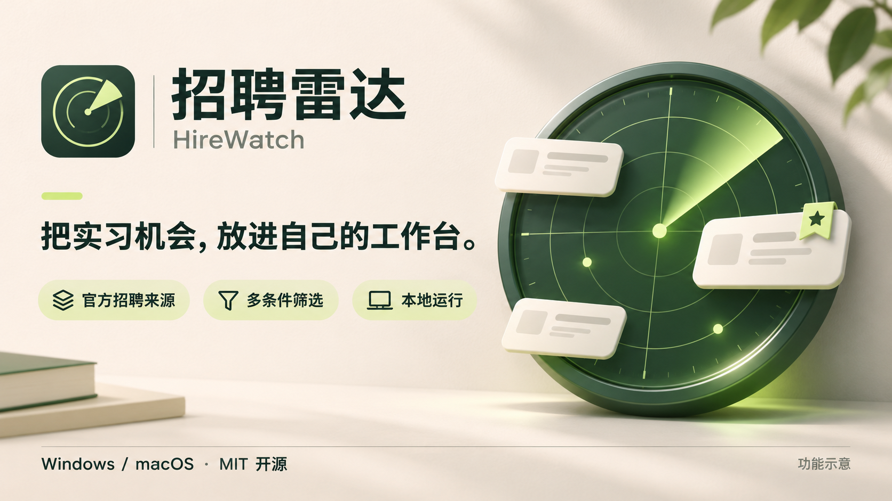
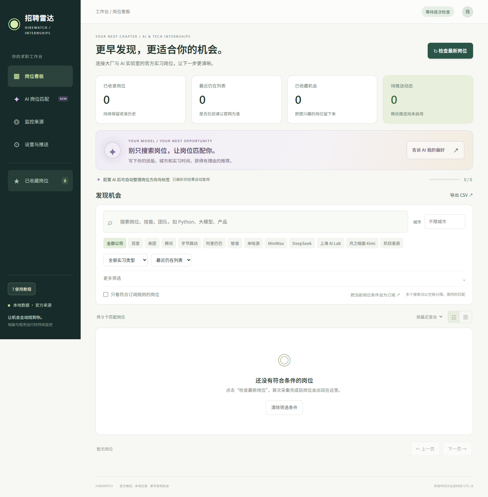
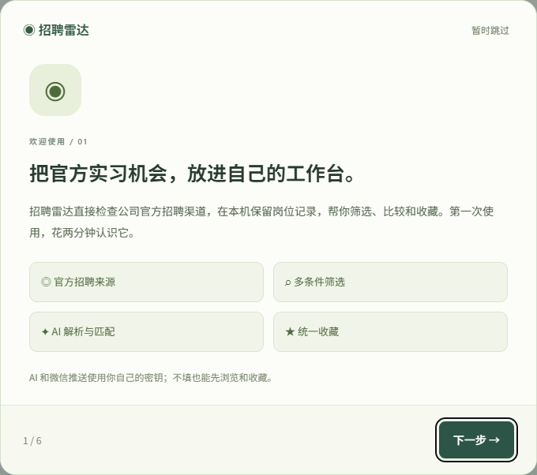
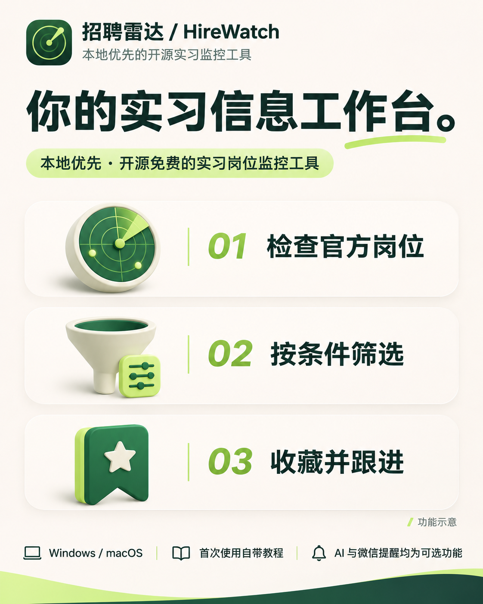

<p align="center">
  
</p>

# 招聘雷达 HireWatch

**一个在自己电脑运行的实习信息工作台。** 定时检查公司官方招聘渠道，集中搜索、筛选、收藏实习岗位；按需连接 DeepSeek / OpenRouter 做 AI 解析与偏好匹配，也可以订阅微信提醒。

[](LICENSE)
[](#开始使用)
[](https://github.com/SongLin99/HireWatch/actions/workflows/ci.yml)

**不填写任何 Key 也能使用：采集岗位、关键词搜索、官网字段筛选、收藏和查看详情都不依赖付费模型。** AI 整理出的岗位类型、技能等高级字段需要先完成解析；微信推送另需自己的推送服务凭据。

## 能做什么

<details>
<summary>查看真实界面与首次教程（全新空数据，无用户信息）</summary>




</details>

- **聚合官方实习信息**：目前有 12 个来源适配器，支持实习与明确接受实习的全职兼招岗位。
- **多条件筛选**：公司、城市、关键词、实习类型、学历、部门、技能标签、每周天数和实习时长等；部分字段由可选 AI 解析获得。
- **统一收藏**：看板、岗位详情和 AI 匹配结果使用同一份收藏，左侧独立入口集中查看。
- **可选 AI**：从原文提取结构化字段；输入求职偏好，比较候选岗位，显示匹配理由与待确认条件。
- **保留部分结果**：评分失败的岗位仍展示，支持在后台补全，刷新后查看新结果。
- **可选微信提醒**：支持 Server酱和企业微信群机器人；按订阅条件推送新增与更新。
- **本地保存**：SQLite 存储岗位、收藏和设置，默认仅监听 `127.0.0.1`。

## 开始使用

推荐 **Python 3.12**。源码运行要求 Python 3.10+；Windows 推荐 Windows 10/11 64 位，Mac 的内置采集浏览器要求 macOS 14+。

1. 点击本页 **Code → Download ZIP**，解压到一个普通文件夹；或者克隆仓库：

   ```text
   git clone https://github.com/SongLin99/HireWatch.git
   cd HireWatch
   ```

2. 从 [Python 官网](https://www.python.org/downloads/) 安装适合系统的 Python 3.12。Windows 安装时勾选 **Add python.exe to PATH**。
3. 运行对应入口：

   | 系统 | 启动方式 |
   | --- | --- |
   | Windows | 双击 `start.cmd` |
   | macOS | 双击 `start.command`；如果 ZIP 解压后缺少执行权限，在终端进入文件夹运行 `bash start.command` |
   | 通用终端方式 | Windows：`py -3 launcher.py`；Mac：`python3 launcher.py` |

首次启动自动建立 `.venv`、安装依赖和采集浏览器，需要联网。之后通常直接复用环境。浏览器会打开本机看板，首次使用自带教程，可跳过，也可从左侧“使用教程”重看。

默认地址是 **http://127.0.0.1:8765**；如果端口被占用，桌面入口会选择附近可用端口并自动打开。启动多个实例会核对同一数据目录，避免重复运行。

4. 在“设置与推送”选择来源和检查间隔，查看“监控来源”的采集进度，再到看板筛选与收藏。首次扫描可能需要几分钟。

关闭网页不会停止后台监控。请从 Windows 托盘 / Mac 菜单栏选择“退出招聘雷达（停止监控）”。电脑休眠、关机、断网或程序退出时不能持续检查。

更详细的三步教程与常见问题见 **[快速上手](docs/快速上手.md)**。

## AI 配置：完全可选

进入 **设置与推送 → AI 服务与预算**：

1. 选择 **DeepSeek 官方** 或 **OpenRouter**。
2. 到对应官方平台创建自己的 API Key，填入界面的密钥输入框并保存。
3. 点击“获取模型列表”选择当前可用模型，或填写准确的模型 ID；不同服务商的 ID 不通用。
4. 设置每日预算，按需勾选启用自动解析并保存。**公开版默认关闭自动 AI 解析**，默认预算上限为每天 5 美元，可调低。

| 服务商 | 申请自己的 Key | 模型说明 |
| --- | --- | --- |
| DeepSeek | [DeepSeek 平台](https://platform.deepseek.com/) | 默认示例 `deepseek-flash`，以账户可用模型为准，参考[官方文档](https://api-docs.deepseek.com/) |
| OpenRouter | [OpenRouter Keys](https://openrouter.ai/settings/keys) | 默认示例 `deepseek/deepseek-v3.2`，也可获取列表选择其他模型 |

**可以一直不填 Key。** AI 功能才会按服务商规则产生调用费用。未知模型没有可用单价时，需要同时填写输入和输出价格以执行预算限制；本机预算是调用前的保守估算，不是服务商账单硬上限。已有解析会复用，岗位原文变化后才重新排队。

AI 匹配描述示例：

> 我会 Python 和 PyTorch，想在上海找 Agent 或大模型实习，每周能到岗 4 天，可以持续 4 个月。希望参与研发，请指出岗位要求中需要确认的条件。

匹配会从当前岗位库筛选候选，再让模型比较所选候选，**不是逐个评分全库，也不保证找到全库最优岗位**。分数表示与描述的适合程度，不代表录用概率。未评分项单独标记，可点击“补全失败岗位”。

## 微信提醒：也可跳过

在“设置与推送”填写订阅条件，选择 Server酱或企业微信群机器人，填写**自己的** SendKey / Webhook 并启用。个人微信无需新注册账号，按 [Server酱](https://sct.ftqq.com/) 的流程绑定接收通道即可。

第一次采集建立基线，不推送已有岗位；以后按订阅条件、冷却时间、每日限制和服务商额度合并推送。它是定时轮询，**不是即时消息源，也不承诺秒级通知**。

## 来源与边界

百度、美团、腾讯、字节跳动、阿里巴巴、智谱、米哈游、MiniMax、DeepSeek、上海 AI Lab、月之暗面 Kimi、阶跃星辰。

这是适配器清单，**不是对这些网站当前可用性或全部岗位覆盖的保证**。接口、页面和访问规则会变化；失败会显示在“监控来源”，保留上次成功数据。“最近未见”不代表官网已关闭岗位，是否在招请打开原始链接确认。

程序访问的是招聘网站的公开页面及其页面使用的接口，并非厂商承诺兼容的公开 API。请遵守来源站点规则与适用法律，不将其用于绕过登录、验证码、权限或其他保护措施，不获取非公开数据，不造成过量访问。本项目与招聘公司及模型、推送服务商没有官方隶属或合作关系。开源许可不授予对第三方网站或数据的使用许可。

## 隐私与密钥

- **仓库和源码 ZIP 不包含任何开发者 API Key、推送凭据、岗位数据库、简历、收藏或匹配历史。**
- 公开版不读取项目根目录的 `openrouter.txt`，推荐在界面填写密钥；高级用户可使用 `OPENROUTER_API_KEY` / `DEEPSEEK_API_KEY` 环境变量。
- 密钥保存在用户自己的本地 SQLite 中，**不是加密保险库**；接口不会回显完整密钥。不要分享 `data/`、数据库、备份或日志。
- 源码运行数据在项目的 `data/`；打包后的 Windows 数据在 `%LOCALAPPDATA%\HireWatch\data`，Mac 在 `~/Library/Application Support/HireWatch/data`。
- 开启 AI 时，岗位原文及匹配描述会发送给所选模型服务商；开启微信推送时，相应通知会发送给推送服务商。未启用的功能不会主动发送这些数据。
- 不要把本机服务直接暴露到公网；当前应用不是多用户服务。

详见 [安全与隐私说明](SECURITY.md)。

## 自己打包 EXE / Mac App

源码版与打包版是两种交付形式。上面的源码 ZIP 需要 Python；原生应用包包含运行环境。可从本仓库 Actions 手动构建，或按 [构建说明](docs/构建说明.md) 在对应系统生成。

- Windows 生成便携 EXE 文件夹及 ZIP，不能只单独复制 EXE。
- Mac 分别生成 Apple Silicon 与 Intel 应用 ZIP，内置采集浏览器；需在 macOS 上构建。
- Mac 默认是 ad-hoc 签名，**没有 Apple Developer ID 签名与公证**；Windows 也没有购买商业代码签名证书。
- CI 测试使用临时数据与模拟模型 / 通知，不使用个人密钥，不发送真实微信。

已生成的历史应用包不自动代表当前源码版本；以对应 Actions 运行与校验文件为准。

## 开发

```text
python -m venv .venv
# Windows: .venv\Scripts\python；Mac: .venv/bin/python
python -m pip install -r requirements-dev.txt
python -m pytest -q
```

上面最后两行需在激活虚拟环境后运行，或替换为对应 `.venv` Python 路径。仅启动服务、不使用托盘：安装 `requirements.txt` 后运行 `python run.py`。关闭自动采集：`python run.py --no-scheduler`。

目录：`hirewatch/` 后端与采集；`web/` 原生前端；`tests/` 回归测试；`scripts/` 审计和打包；`docs/` 教程、构建说明与宣传图。

欢迎提交 Issue / Pull Request。报告问题时请删除密钥、SendKey、Webhook、个人描述和本机路径；请勿附上数据库。

## 宣传素材

图片在 [docs/images](docs/images)，是 AI 生成的功能示意海报，不是真实岗位或产品截图；不包含用户数据。可用于介绍本项目，请保留项目名称并避免暗示官方招聘合作或保证岗位覆盖。

<p align="center">
  
  
</p>

## 许可

[MIT](LICENSE)。第三方依赖及其附带资源继续遵循各自许可；打包脚本保留主要依赖许可文件。招聘信息的权利归相关权利人，不因代码开源而改变。
